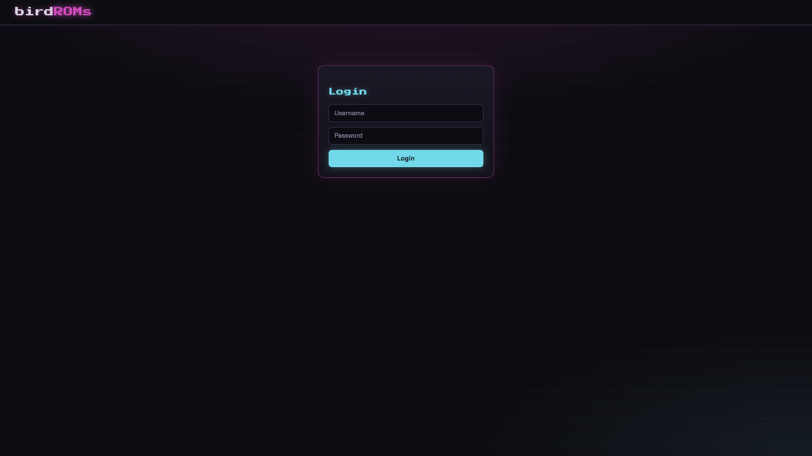
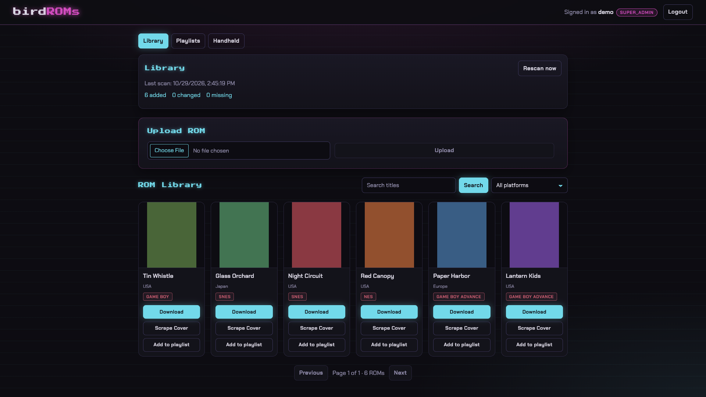
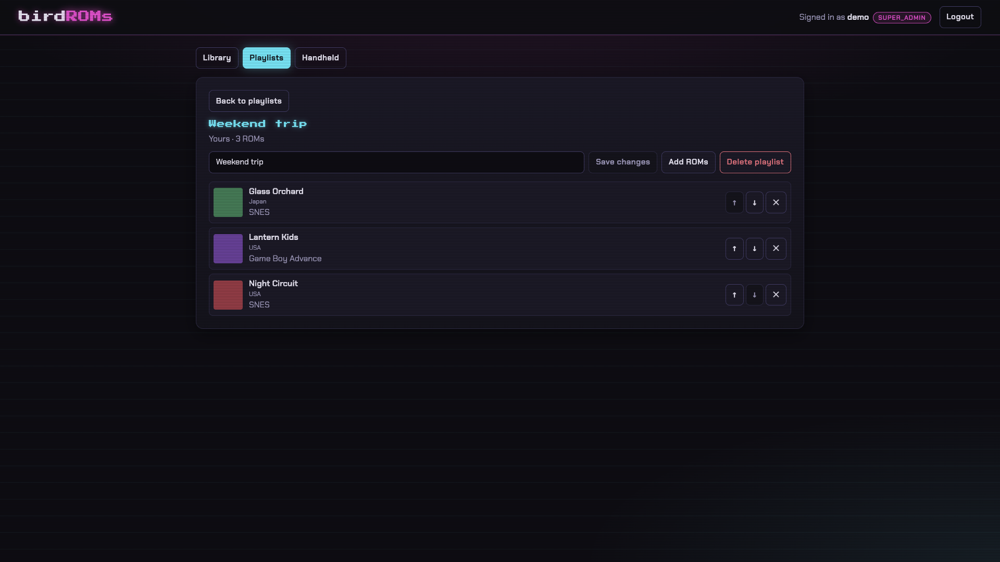
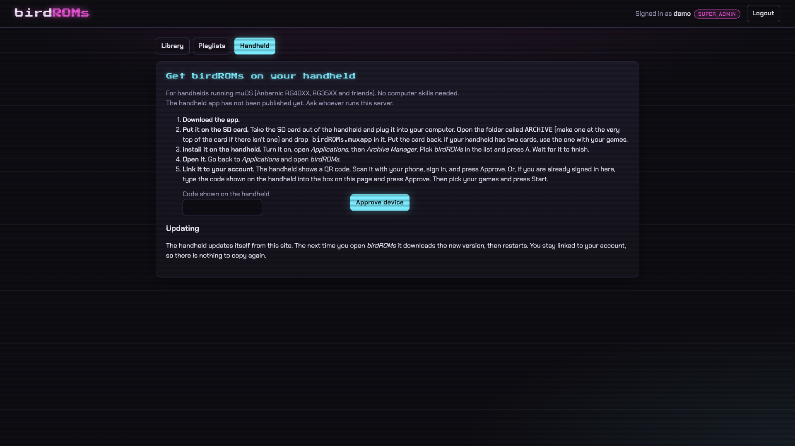

# birdROMs

[](https://github.com/amtypaldos/birdROMs/actions/workflows/ci.yml)
[](LICENSE)

birdROMs is a self-hosted retro ROM library. Friends sign in to a Django API and React web app, browse your
games with cover art, upload ROMs and download them. An optional muOS handheld app
([birdroms-handheld](https://github.com/amtypaldos/birdroms-handheld)) does the same from the device.
Everything runs on your hardware; there is no central service.



Out of scope: online play, netplay and online save-state sync. (To sync saves between your own devices,
use something like Syncthing.)

> **ROMs and copyright.** birdROMs ships no ROMs, BIOS files or other copyrighted game content. You are
> responsible for storing and sharing only content you have the right to use and share. The project and
> its contributors accept no responsibility for what you host.

## What it does

- **Reads the library you already have.** Point it at a muOS-style tree, `ROMS/<SYSTEM>/<game file>` with
  box art in `ROMS/<SYSTEM>/Imgs/`, on a folder, an NFS share or an S3-compatible bucket. A scan every
  15 minutes indexes it in place. birdROMs never deletes, moves, renames or overwrites your files.
- **Uploads** from the browser go into the right system folder (unknown platforms go to
  `ROMS/_UNSORTED`). Any signed-in user can upload and create playlists.
- **Titles are display-only.** `Super Mario World (USA) [!].sfc` shows as a clean title with its tags, but
  downloads always use the original file name, because muOS and RetroArch key saves, states and box art
  to it.
- **Cover art** comes from the library first, then libretro-thumbnails and ScreenScraper in the
  background.
- **Playlists**, platform detection from folder names and extensions, and an installable web app (PWA,
  needs HTTPS).
- **Private.** Every download goes through a permission-checked API that streams the file, even from S3.
  There is no public URL for a ROM or its cover.



## Quick start (Docker)

You need Docker Engine 24+ with Compose v2.24+.

```bash
git clone https://github.com/amtypaldos/birdROMs.git && cd birdROMs
cp backend/.env.example backend/.env
# edit backend/.env: DJANGO_SECRET_KEY, DJANGO_DEBUG=False, DJANGO_ALLOWED_HOSTS,
# DJANGO_CSRF_TRUSTED_ORIGINS and POSTGRES_PASSWORD at least

# prebuilt images (amd64 + arm64) ...
export BIRDROMS_BACKEND_IMAGE=ghcr.io/amtypaldos/birdroms-backend:latest
export BIRDROMS_WEB_IMAGE=ghcr.io/amtypaldos/birdroms-web:latest
docker compose -f docker-compose.prod.yml pull
docker compose -f docker-compose.prod.yml up -d
# ... or build locally: docker compose -f docker-compose.prod.yml up -d --build

docker compose -f docker-compose.prod.yml exec backend python manage.py createsuperuser
```

birdROMs is now on `http://<host>:8080`. Sign in with that account; a Django superuser is a `super_admin`.
The stack is PostgreSQL, Redis, gunicorn, a worker (library scans, cover scraping) and nginx. The library
starts as an empty Docker volume: upload ROMs, or mount an existing library (host folder, NFS or S3).

**Read [SELF_HOSTING.md](SELF_HOSTING.md) before exposing it to the internet.**

| Doc | Covers |
| --- | --- |
| [SELF_HOSTING.md](SELF_HOSTING.md) | First install: configuration, HTTPS, SSO, storage, backups, troubleshooting |
| [docs/deploying.md](docs/deploying.md) | Runbook: images, NFS/S3 library, reverse proxy, first scan, backups, updates, rollback |
| [docs/upgrading-to-the-library.md](docs/upgrading-to-the-library.md) | Moving from the old upload-only storage to the library |
| [docs/handheld-app.md](docs/handheld-app.md) | Publishing the muOS app from your server |
| [backend/.env.example](backend/.env.example) | Every setting, with comments |
| [SECURITY.md](SECURITY.md) | Reporting a vulnerability |

### Images

`ghcr.io/amtypaldos/birdroms-backend` and `ghcr.io/amtypaldos/birdroms-web`, for linux/amd64 and
linux/arm64. Every push to `main` publishes `latest` and `sha-<7 chars>`. A release tag
`vYYYY.MM.DD` (or `vYYYY.MM.DD.N` for a second release that day) publishes `YYYY.MM.DD[.N]` and moves
`latest`. Pin a `sha-` or date tag if you want one-edit rollbacks. See
[docs/deploying.md](docs/deploying.md#1-images).

## Roles and sign-in

Three roles, stored as Django groups:

- `super_admin`: everything, plus editing and deleting ROM entries, re-scraping covers and running the
  Library page (status, rescans, accepting removals) and invites. Deleting an entry removes it from
  birdROMs only, never the file.
- `member`: browse, download, use playlists, pair a handheld, and upload ROMs. Cannot edit, delete or
  re-scrape ROMs, use the Library page, or make invites.
- `readonly`: browse, download, use playlists and pair a handheld. Cannot upload.

A user with no role group can do nothing. If a user is in more than one role group, the most powerful
one wins (`super_admin`, then `member`, then `readonly`). Any signed-in user can create playlists, and
only a playlist's creator can change it. Assign roles to local users in Django admin (add them to the
group); SSO users get theirs from the provider.



### Login methods

`AUTH_METHODS` is `local`, `oidc`, or both (`local,oidc`). The web UI reads `GET /api/auth/config/` and
shows only what is on.

| Setup | Env |
| --- | --- |
| Local only (default) | `AUTH_METHODS=local` |
| Local, sign-up open | `AUTH_METHODS=local`, `ALLOW_REGISTRATION=true` |
| SSO only | `AUTH_METHODS=oidc`, `ALLOW_LOCAL_LOGIN=False` |
| Both | `AUTH_METHODS=local,oidc` |

- **Local.** `ALLOW_LOCAL_LOGIN` force-enables local login and defaults to `DJANGO_DEBUG`. With local
  login off, the login, register and invite endpoints return 404.
- **Self-registration is closed by default**, even with local login on. `ALLOW_REGISTRATION=true` or
  `false` overrides Django admin. If it is unset, the **Allow registration** checkbox under *Accounts >
  Registration settings* in Django admin decides, and the default row is closed. Registration also
  needs local login. Self-registered users are `readonly`. The login page shows **Create account** only
  when registration is actually open; `GET /api/auth/config/` reports this as `registration`. Once open,
  anyone who can reach the site can download every ROM.
- **Invites** are the other way to add a local account, and they work while self-registration is closed.
  A `super_admin` makes a one-time link from **Invite a friend** on the Library page, with
  `python manage.py create_invite [--role readonly|member|super_admin] [--days N] [--label NAME] [--base-url URL]`,
  or with `POST /api/auth/invites/`. The link (`/invite/<token>`) works once, expires after
  `INVITE_TTL_DAYS` (default 7), and can be revoked (`DELETE /api/auth/invites/<id>/`, or in Django admin).
  Only a SHA-256 digest of the token is stored, so the link is shown once at creation and cannot be
  recovered. The friend picks a username and password and is signed in. The default role is `readonly`.
  Invites need local login: with it off, the web UI hides **Invite a friend** and `/invite/<token>` shows
  that invite links are unavailable (`GET /api/auth/config/` reports this as `invites`).
- **SSO** is one OpenID Connect provider (Pocket ID, Authentik, Keycloak, Authelia, Google) using the
  Authorization Code flow with PKCE. Members of `OIDC_ADMIN_GROUP` (from the `OIDC_GROUPS_CLAIM` claim)
  become `super_admin`. Otherwise members of the optional `OIDC_MEMBER_GROUP` become `member` (leave it
  empty and SSO never assigns member); everyone else is `readonly`. The role is re-synced on every SSO login. Users
  are matched on the provider's `sub`, never on username; `OIDC_LINK_BY_EMAIL=True` opts in to linking
  existing local accounts by verified email. SAML is not supported. To limit who can sign in at all, set
  `OIDC_ALLOWED_GROUPS` (members of any listed group, from `OIDC_GROUPS_CLAIM`) and/or
  `OIDC_ALLOWED_EMAIL_DOMAINS` (the email's domain, accepted only when the provider marks the email
  verified). With either set, a user who matches neither is refused and no account is created; with
  both empty, everyone your provider accepts gets in.

**Sessions.** Both methods sign the browser in with an **HttpOnly session cookie** (`SameSite=Lax`,
`Secure` behind an HTTPS proxy). The web UI keeps no token in `localStorage` and never sees the
cookie. The session lasts `SESSION_COOKIE_AGE` seconds (default 14 days) and renews on activity;
changing a password ends that user's sessions. Unsafe requests (login, logout, uploads, ...) are
CSRF-protected: `GET /api/auth/csrf/` sets the script-readable `csrftoken` cookie, and the SPA echoes it
in `X-CSRFToken`. Anything scripting the API with a session must do the same. Logging in is rate-limited
per username and per client address, as is the Django admin login.

**Handheld device tokens are unchanged:** a paired handheld sends `Authorization: Device <token>`, can only
read (any write is a 403), and is revocable in Django admin. A device that goes unused for
`DEVICE_TOKEN_IDLE_DAYS` (default 365, `0` = never) stops working and must be paired again.

The SSO callback URL is `https://<host>/api/auth/oidc/callback/`; the
Pocket ID walk-through and env block are in [SELF_HOSTING.md](SELF_HOSTING.md#6-single-sign-on-oidc--pocket-id-example).
Other providers use the same variables with different values:

- **Authentik:** `OIDC_ISSUER=https://authentik.example.com/application/o/<slug>`,
  `OIDC_SCOPES=openid email profile` (groups arrive in the default `profile` scope).
- **Keycloak:** `OIDC_ISSUER=https://keycloak.example.com/realms/<realm>`, plus a "Group Membership"
  mapper (claim `groups`, full group path off) on the client.
- **Google:** `OIDC_ISSUER=https://accounts.google.com`, `OIDC_SCOPES=openid email profile`. Google has
  no groups claim, so everyone is `readonly`. Promote users in Django admin; the role resets at their
  next SSO login unless they are a Django superuser.

## Library and storage

The **library** is the muOS-layout tree above. `LIBRARY_BACKEND` is `filesystem` (default,
`LIBRARY_ROOT`, `/library` in Docker; an NFS mount is just a folder) or `s3` (set `LIBRARY_S3_PREFIX`
to keep it apart from other bucket content). It defaults to the value of `STORAGE_BACKEND`.

- A scan runs every 15 minutes (`LIBRARY_SCAN_CRONTAB`, needs the worker), with
  `python manage.py scan_library`, or from the Library page. It adds new files, updates changed ones and
  marks vanished files missing (hidden, not deleted). A scan that would hide more than 25% of known
  ROMs aborts, so an unmounted share cannot empty the library.
- Uploads and scraped covers are written into the library. `LIBRARY_WRITE_COVERS=False` keeps covers out;
  `LIBRARY_READ_ONLY=true` stops all writes, including uploads.
- **Media storage** (`MEDIA_ROOT`, or S3 with `STORAGE_BACKEND=s3` and the `S3_*` variables) holds
  scraped covers and the published handheld package. S3 objects are never public.

Setup, NFS write permissions, backups and the first-scan runbook are in
[docs/deploying.md](docs/deploying.md#3-the-library) and [SELF_HOSTING.md](SELF_HOSTING.md#7-your-rom-library-volume-host-folder-nfs-or-s3).

### Uploads

`POST /api/roms/` rejects (400 on `file`) an extension outside the allowlist, an empty file, a file over
`MAX_ROM_UPLOAD_BYTES` (default 2 GiB), a name that already exists in that system folder (uploads never
overwrite), or a read-only or unreachable library. Behind a reverse proxy, raise its body limit to match
(`NGINX_CLIENT_MAX_BODY_SIZE` for the bundled nginx).

The platform comes from the extension, case-insensitively. The allowlist is `EXTENSION_TO_PLATFORM` in
`backend/apps/roms/services.py`; it covers dozens of systems plus `.zip`/`.7z`. During a library scan the
system folder wins (`backend/apps/roms/data/platform_aliases.csv`) and the extension decides inside shared
folders. Disc images (`.iso`, `.bin`, `.cue`, `.chd`) are shared by many systems, so set `platform`
explicitly when uploading them.

### Downloads and the API

`GET /api/roms/{id}/download/` needs a signed-in user or a paired device token and returns the file with
its **original file name** in `Content-Disposition`. `GET /api/roms/` is paginated and takes `search`,
`platform`, `page` and `page_size`; `GET /api/roms/platforms/` lists platforms that have ROMs.

### Cover art

Library box art is used first. For the rest, a background task tries `COVER_ART_PROVIDERS` in order
(default `libretro`, then `screenscraper`) and stores the image, so covers keep working offline.
ScreenScraper needs `SS_DEV_ID` and `SS_DEV_PASSWORD` (optional `SS_USER`, `SS_PASSWORD`); without them it
is skipped. Scraping never fails an upload or scan. Set `COVER_ART_PROVIDERS=` to turn it off.
`super_admin` can re-scrape one ROM (`POST /api/roms/{id}/scrape_cover/`); `python manage.py backfill_cover_art`
fills in existing ROMs (`--force` re-scrapes all).

## Handheld app

The muOS client lives in [birdroms-handheld](https://github.com/amtypaldos/birdroms-handheld). Your
server stores `birdROMs.muxapp`; signed-in users get a **Handheld** page with install steps and a download
that adds `server.json` with this server's address. On the device, pair by scanning the QR code with your
phone, or type the short code shown on the device into the Handheld page. Then pick playlists or
platforms and press Start. Device tokens are read-only and revocable.



A paired device updates itself from the package published on your server, not from GitHub. The backend
image bundles the handheld release named in [`handheld-version`](handheld-version). The server's own
release tag does not have to match it. `python manage.py publish_handheld` is the manual fallback.
Details: [docs/handheld-app.md](docs/handheld-app.md).

## Development

Local development is native: `uv`, `yarn` (via corepack) and a local PostgreSQL with the `birdroms`
role. [`just`](https://github.com/casey/just) wraps the common commands. Full setup, tests and pull
request rules are in [CONTRIBUTING.md](CONTRIBUTING.md).

```bash
just db-init                                  # creates the birdroms role and database
cd backend && uv sync && cp .env.example .env # set LIBRARY_ROOT to a writable folder
uv run python manage.py migrate && uv run python manage.py createsuperuser
cd ..
just backend                                  # Django on http://localhost:8000
cd frontend && yarn install && cd ..
just frontend                                 # UI on http://localhost:5173
just test                                     # backend and frontend tests
```

Stack: Django 5, Django REST Framework, PostgreSQL, Huey + Redis for background tasks (immediate mode in
dev), React 19 + Vite 8, Authlib for OIDC. Layout: `backend/`, `frontend/`, `docs/`, `scripts/`.
GitHub Actions run backend tests, frontend lint/test/build and Docker builds on every push and pull
request.

## License

birdROMs is released under the [MIT License](LICENSE). The bundled web fonts (Chakra Petch and Press
Start 2P) are under the SIL Open Font License 1.1; see [THIRD_PARTY_NOTICES.md](THIRD_PARTY_NOTICES.md).
See also [CODE_OF_CONDUCT.md](CODE_OF_CONDUCT.md) and [SECURITY.md](SECURITY.md).
